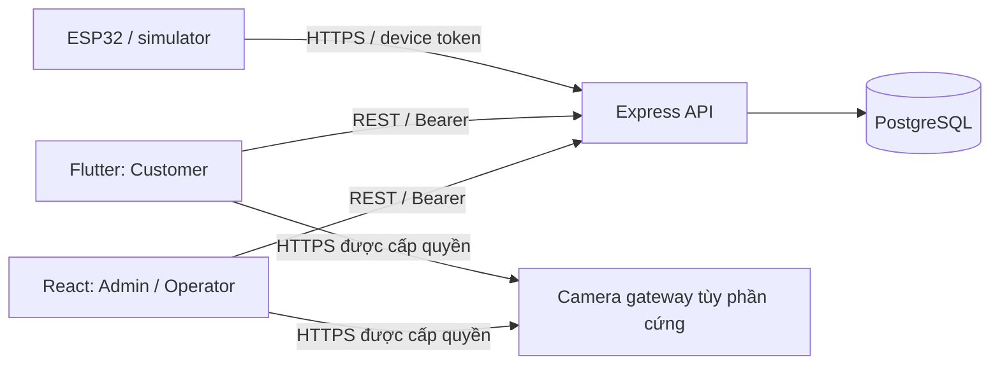
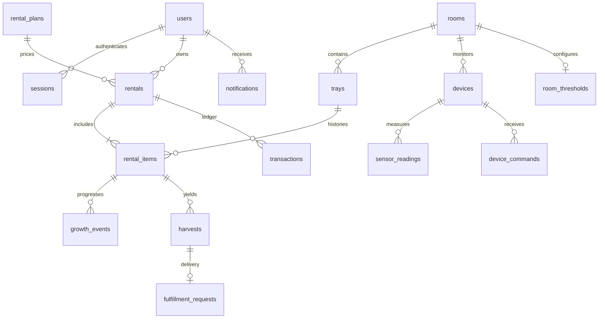

# Kiến trúc và thiết kế dữ liệu

Ngày thiết kế: 2026-11-05. Phạm vi theo SRS; trạng thái triển khai xem `TIEN_DO_CODEX.md`.

Express tách config, DB/migration, auth, routes và dịch vụ nghiệp vụ. Database là nguồn dữ liệu duy nhất; không có mock DB thay cho PostgreSQL trong integration test. API trả JSON `{data: ...}`, lỗi `{error: {code, message}}`; UUID, thời gian ISO-8601 và tiền nguyên VND. Health liveness độc lập DB; readiness phải truy vấn DB.

## Mô hình quan hệ

UUID PK, FK RESTRICT mặc định, `timestamptz`, CHECK cho trạng thái/phạm vi, unique email chuẩn hóa lowercase và code khay. Index theo device/time, user/time, rental/owner và partial unique thuê đang hoạt động. Migration nằm trong `server/migrations/`; tài liệu không thay thế schema thực thi.

## Quyền truy cập

| Nhóm route | Administrator | Operator | Customer | Device |
|---|---|---|---|---|
| Register/login/logout/me | Có | Có | Có | Không |
| Users/price plans/config thresholds/device provisioning | Có | Xem gói | Xem gói active | Không |
| Rooms/trays/growth/harvest | CRUD | CRUD vận hành | Chỉ dữ liệu của thuê mình | Không |
| Rentals | Xem/gán/đóng | Xem/gán/đóng | Tạo/xem của mình | Không |
| Sensor/camera | Xem | Xem | Chỉ phòng thuê đang hoạt động | Gửi readings của chính device |
| Device commands | Dry-run mặc định | Dry-run mặc định | Không | Poll/ack của chính device |
| Notifications/fulfillment | Theo quyền nghiệp vụ | Theo quyền nghiệp vụ | Của mình | Không |

Admin không cần đọc mật khẩu hay hash. Đầu vào unknown keys bị từ chối ở các form nhạy cảm. Không ghép chuỗi input vào SQL. Token không ghi log. Mỗi API truy cập item cụ thể phải truy vấn ownership, tránh chỉ kiểm tra role ở đầu route.

## Vòng đời

- Rental: `active → completed`; đóng đồng bộ toàn bộ rental items, giữ sự kiện cũ. Gia hạn/đặt trước chưa thuộc phiên bản đầu.
- Tiến trình: `incubation → fruiting → ready → harvested`; cập nhật có ghi sự kiện và mốc thu hoạch dự kiến.
- Yêu cầu nhận/giao: `requested → processing → completed`, hoặc `requested → cancelled`.
- Command: dry-run chỉ lưu bằng chứng; command thực phải được bật riêng sau nghiệm thu phần cứng; `pending → acknowledged/expired/failed` có TTL và kết quả.
