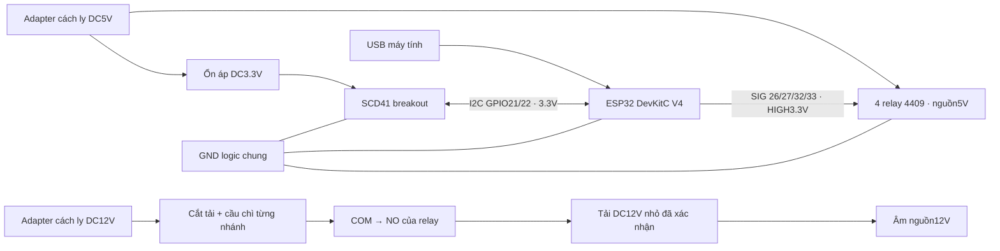

# Phương án IoT để xác nhận trước lắp ráp

**ĐỀ XUẤT, CHƯA ĐƯỢC XÁC NHẬN / CHƯA THỬ PHẦN CỨNG.** Không giả định đã mua thiết bị. Đề tài yêu cầu ESP32, nhiệt độ/độ ẩm/CO₂ và điều khiển môi trường; model, GPIO, điện áp và giới hạn bên dưới là quyết định kỹ thuật đề xuất, không phải thông số giảng viên bắt buộc. Không có lệnh flash hoặc bật tải thật đã thực hiện.

## Danh sách linh kiện và lý do

| Linh kiện | Số lượng | Cấu hình đề xuất / lý do |
|---|---|---|
| ESP32-DevKitC V4, module ESP32-WROOM-32E | 1 | Wi-Fi, I²C và đủ GPIO; phù hợp core/FQBN `esp32:esp32:esp32` đang compile. Không áp dụng nguyên sơ đồ này cho ESP32-C3/S3 |
| SCD41 breakout tương thích I²C logic 3.3V | 1 | Đo CO₂ thực bằng nguyên lý quang âm, tích hợp nhiệt độ/độ ẩm, cùng driver SCD4x hiện có; giảm số bus/driver |
| Adafruit STEMMA Non-Latching Mini Relay #4409 + cáp JST-PH 3 chân | 4 | Có mạch kích; SIG 3.3V HIGH bật, LOW tắt. Mất nguồn cuộn relay nhả; phù hợp profile active-HIGH, không thay bằng module active-LOW chưa kiểm tra |
| Adapter DC5V ổn áp, cách ly thương mại, dự kiến 2A + bộ ổn áp DC3.3V có dự phòng dòng | 1 bộ | Nguồn relay/cảm biến riêng; kiểm tra dự toán dòng theo module mua thực tế. Không cấp relay từ GPIO hoặc từ chân 3V3 của ESP32 |
| Adapter DC12V cách ly, dây/cầu chì/công tắc cắt tải | 1 bộ | Chọn dòng sau khi có thông số tải, gồm dòng khởi động; không mặc định nguồn đủ công suất |
| Bơm/van phun sương DC12V, quạt DC12V, đèn DC12V, bộ sưởi PTC DC12V | Mỗi loại 1 | Prototype tải nhỏ; mục tiêu dòng liên tục ≤0.5A/kênh là giới hạn thiết kế đề xuất, chưa chứng minh tương thích. Cần model, dòng khởi động và định mức tiếp điểm trước mua/đấu |
| Điện trở kéo xuống SIG 10kΩ, terminal/hộp chống ẩm, cầu chì từng nhánh, diode/TVS phù hợp tải | Theo sơ đồ | Giữ OFF khi boot/reset, giảm xung tải cảm và bảo vệ dây; bảo vệ cuộn relay có sẵn không thay bảo vệ motor/van bên ngoài |
| Thermostat và cầu chì nhiệt độc lập cho sưởi | 1 bộ | Ngắt nhiệt dù firmware treo hoặc relay dính; không dựa vào phần mềm làm bảo vệ nhiệt duy nhất |
| IP camera/gateway HTTPS có xác thực | Tùy chọn | Nguồn video thật cho URL hiện có. Không mặc định URL công khai hoặc quyền xem chỉ được bảo vệ bởi API ứng dụng |

Nguồn xác minh model: [Espressif DevKitC V4](https://docs.espressif.com/projects/esp-dev-kits/en/latest/esp32/esp32-devkitc/user_guide.html), [Sensirion SCD41](https://sensirion.com/products/catalog/SCD41), [relay Adafruit #4409](https://www.adafruit.com/product/4409). Trang relay công bố tiếp điểm đến 2A với tải thuần trở ở 30VDC và yêu cầu giảm định mức với tải cảm; con số đó **không phải** bảo đảm cho motor/van bất kỳ. Trạng thái active-HIGH và sơ đồ nguồn được đối chiếu với [pinout chính hãng](https://learn.adafruit.com/adafruit-stemma-non-latching-mini-relay/pinouts).

## Bảng nối dây dự kiến, chưa cho phép cấp tải

| Tín hiệu | Chân / nguồn |
|---|---|
| SCD41 SDA / SCL | GPIO21 / GPIO22; pull-up chỉ lên 3.3V; địa chỉ I²C 0x62 |
| SCD41 VDD / GND | Nguồn 3.3V ổn áp phù hợp **breakout đã chọn**, GND logic chung; xác nhận datasheet module trước cấp điện |
| Relay mist / fan / light / heater SIG | GPIO26 / GPIO27 / GPIO32 / GPIO33; mỗi SIG có kéo xuống 10kΩ về GND |
| Relay dây đỏ / đen | DC5V nguồn ngoài / GND logic chung; dây trắng là SIG 3.3V, không đưa 5V vào GPIO |
| ESP32 | Cấp qua USB; không đồng thời đưa nguồn ngoài vào chân 5V/3V3 của board |
| Mỗi tiếp điểm relay | +12V → cầu chì nhánh → COM; NO → tải(+); tải(−) → nguồn12V(−). NC để trống, OFF mặc định |

Sơ đồ biểu diễn hai miền nguồn; đường SIG chỉ điều khiển relay. Không nối +5V nguồn ngoài với +5V USB. Espressif yêu cầu chọn một phương án cấp nguồn cho board; không cấp đồng thời nhiều đầu nguồn. Không đấu điện lưới trên breadboard. Phương án này chỉ đề xuất tải12VDC; tải trại thực tế công suất lớn cần thiết kế điện riêng bởi người có chuyên môn.

SCD41 phải tránh tia phun và ngưng tụ, đặt thông thoáng, đối chiếu nhiệt/ẩm/CO₂ với máy tham chiếu. Kiểm tra offset do tự gia nhiệt, vị trí lắp và quy trình hiệu chuẩn của hãng; không tự bật hiệu chuẩn cưỡng bức hoặc giả định phòng nấm luôn được đưa về khí trời. Chưa có bằng chứng độ chính xác trong phòng nấm thực.

## Cơ chế phần mềm đã triển khai

- Mặc định `SM_ENABLE_HARDWARE_OUTPUTS=0`; simulator không ghi GPIO dù bật macro này. Chỉ profile SCD4x và macro1 mới chứa driver output. Biên dịch profile không flash thiết bị.
- Backend mặc định `HARDWARE_ACTUATION_ALLOWLIST` rỗng; danh sách UUID chỉ được cấu hình **sau khi xác nhận phần cứng**. Không có API/Web để tự mở khóa cấu hình này. Docker cũng mặc định rỗng.
- Web mặc định gửi dry-run. Khi server báo khả dụng mới hiện lựa chọn bỏ dry-run; API vẫn kiểm tra vai trò, mode, UUID, mẫu hardware mới ≤30s và thời lượng1–10s. Customer Flutter chỉ giám sát theo quyền thuê, không có quyền điều khiển.
- Lệnh thật pending có TTL15s, lệnh mới cùng actuator thay thế lệnh pending cũ. Poll/ack khóa và kiểm lại token đang hiệu lực; ack chỉ đúng thiết bị, chưa hết hạn và chưa xử lý.
- Firmware kiểm tra NTP/TTL và ID chống áp dụng lặp; không kéo dài pulse đang bật. Task riêng kiểm tra mỗi10ms, tắt theo thời hạn tối đa10s dù HTTP bị chờ. Mất trạng thái server quá15s hoặc sensor quá30s thì tắt. Không khẳng định thời gian điện chính xác10ms trên board chưa đo.
- Quạt ưu tiên sưởi: bật quạt xóa xung sưởi, sưởi bị từ chối khi quạt đang bật. Automation dùng mẫu mới, tạo xung10s và chỉ yêu cầu lại ON sau30s; manual có thể yêu cầu xung mới sau khi xung cũ kết thúc. Giới hạn duty-cycle/cooldown cho từng tải cần nghiệm thu trước vận hành liên tục.
- ACK nghĩa là firmware chấp nhận lập lịch GPIO, **không phải** đo xác nhận tiếp điểm/điện/tải. Chưa có cảm biến feedback. Firmware/task/watchdog phần mềm không thay cầu chì nhiệt, cắt điện và đánh giá relay dính.

## Trình tự xác nhận và nghiệm thu còn lại

1. Người dùng xác nhận model board/breakout/relay, mức kích, bảng chân; model tải, điện áp, dòng liên tục/khởi động; nguồn/cầu chì và giới hạn xung an toàn thực tế. Nếu thời gian an toàn <10s phải giảm giới hạn trong source/backend trước thử.
2. Kiểm tra sơ đồ và nguồn bằng đồng hồ khi **chưa nối tải**. GPIO có pull-down và relay dùng NO; kiểm tra boot/reset/mất USB/nguồn coil.
3. Sau khi được phép flash: thử simulator rồi sensing-only, log Serial/API; kiểm tra sai token, TLS/clock, I²C lỗi và mẫu đối chiếu. Chưa enable output/allowlist ở bước này.
4. Chỉ sau khi được phép: profile output +UUID allowlist, thử LED/tải giả công suất thấp trước. Đo xung, OFF/TTL/replay, mất Wi-Fi, API lỗi, sensor lỗi, reboot, fan/heater interlock; sau đó mới xét từng tải thật đã chốt.
5. Ghi BOM thực tế, ảnh dây, phiên bản firmware/commit, log và phép đo. Camera cần luồng thật và kiểm tra quyền truy cập riêng. Các bước này hiện **BLOCKED: chưa xác nhận/không có thiết bị**.

Phần mềm API/React/Flutter và biên dịch firmware vẫn được phát triển/kiểm thử trong khi chờ phần cứng; không thay nhãn simulator thành cảm biến thật để báo hoàn thành.
