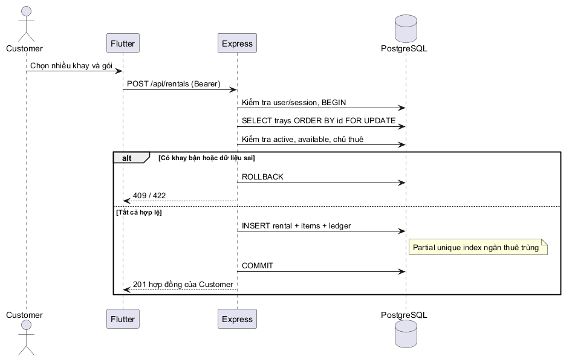

# Thiết kế chi tiết và mô hình UML 2.0

## Tổ chức source

| Thành phần | Trách nhiệm |
|---|---|
| `server/src/config.js`, `index.js` | Validate môi trường, lifecycle HTTP, shutdown pool |
| `db.js`, `migrate.js`, `migrations/` | Pool PostgreSQL, transaction, migration append-only có checksum/advisory lock |
| `security.js`, `auth.js` | scrypt+salt, token ngẫu nhiên/hash, sessions/expiry/revoke, role middleware |
| `catalog.js`, `users.js` | CRUD nền tảng, projections phục vụ gán thuê, last admin và soft delete |
| `rentals.js` | Ownership helpers, all-or-nothing rentals, link đúng chủ, complete đồng bộ |
| `operations.js` | Stage/harvest/fulfillment/ledger/notifications/dashboard/reports/CSV |
| `iot.js` | Device auth/ingest/provenance, room access, thresholds/alerts, dry-run automation và camera contract |
| `web/src/` | React theo vai trò, form/loading/error, polling, download CSV; token RAM |
| `mobile/lib/` | MushroomApi injectable HTTP client, Customer screens và widgets; session RAM, reset navigation khi logout/401 |
| `iot/` | Simulator độc lập và firmware mới, dùng chung REST contract, tách nhãn mô phỏng/hardware |

API là modular monolith, chưa dùng microservices/broker. Domain model biểu diễn bởi bảng SQL và module dịch vụ, không có ORM entity classes.

## Đồng thời và toàn vẹn

- Migration: một transaction, advisory lock `56051105`, kiểm tra checksum mỗi file. Không có lệnh down/destructive migration.
- Bootstrap/last admin: advisory lock `56051106`; không thể xóa/khóa/hạ role admin hoạt động cuối. Thay password/role/vô hiệu hóa thu hồi sessions.
- Thuê: xác minh customer active đúng role, khóa SHARE customer và gói, khóa khay theo UUID, kiểm tra phòng/khay active và item chưa ended. Tạo rental/items/ledger/notification trong cùng transaction. Partial unique index là lớp bảo vệ cuối cùng.
- Progress/harvest: khóa rental trước item; chỉ hoạt động khi item chưa ended. Stage tiến từng bước; harvest chỉ từ ready. Event/notification và stage update cùng commit.
- Đóng: khóa rental, cần giao dịch paid và mọi harvest đã bàn giao, rồi ended toàn bộ items/completed rental trong một transaction. Hết expected date không tự đóng.
- Fulfillment: chỉ chủ harvest của rental active tạo được, một request/harvest. Staff xử lý requested→processing→completed; chủ có thể cancel requested hoặc gửi lại cancelled.
- Telemetry: khóa room để chống trùng cảnh báo/command automatic khi ingest song song; timestamp ở server, không nhận timestamp cũ từ client. Mẫu offline không được gửi lại dưới nhãn thời gian hiện tại.
- Không xóa dây chuyền lịch sử bằng cascade. API xóa room/tray/plan bị FK chặn nếu có dữ liệu liên quan; user xóa mềm.

## Xác thực và quyền dữ liệu

Session token 32 bytes ngẫu nhiên, SHA-256 trong DB, TTL12h; device token cùng độ dài nhưng lookup bảng riêng. Không dùng JWT/refresh token. Customer detail dùng SQL lọc customer_id, sai chủ trả 404. Environment/camera cần thuê active trong phòng; lịch sử environment chỉ từ thời điểm sớm nhất của thuê đang active tại phòng. Người thuê sau không đọc được growth/harvest của item cũ.

Các route đọc lịch sử có giới hạn; phiên bản đầu chưa có pagination đầy đủ, không tuyên bố mở rộng vô hạn. Camera URL HTTPS không userinfo, API không fetch URL, nhưng gateway phải tự bảo vệ live stream; URL không phải hệ thống camera hoàn chỉnh.

## UML 2.0 (source PlantUML)

- `uml/use-cases.puml`: tác nhân và use cases.
- `uml/domain-class.puml`: class diagram khái niệm với multiplicity.
- `uml/rental-sequence.puml`: sequence transaction thuê.
- `uml/lifecycles.puml`: state machines rental/growth/fulfillment.
- `uml/rental-activity.puml`: activity xác nhận thuê và nhánh lỗi.
- `uml/deployment.puml`: deployment mục tiêu; container/domain chưa được nghiệm thu.

ERD ở `KIEN_TRUC.md` là sơ đồ DB riêng, không thay thế UML class diagram. Đã render 6 source bằng PlantUML1.2026.9/Smetana, PNG tại `uml/rendered/`; chạy lại bằng `scripts/render-uml.ps1` với Java/PlantUML riêng. Các UML không khẳng định có class runtime tương ứng với tên domain.

## Giới hạn thiết kế còn mở

Chưa có pagination/filter đầy đủ, scheduled cleanup sessions/telemetry, cảnh báo offline tự động, audit trail đầy đủ cho mọi thay đổi cấu hình, refresh/secure persistent session, chart downsampling hay benchmark tải. Nuôi trồng hiện gắn rental item; quản lý chu kỳ riêng cho khay của nông trại không có hợp đồng chưa triển khai. Cần xác nhận mở rộng nghiệp vụ này nếu dùng vận hành ngoài đồ án.
